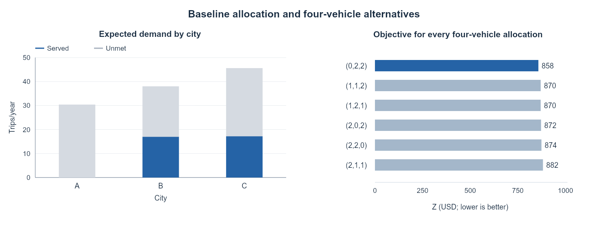

# Baseline numerical experiments

## Shared experiment design

Both cases solve the baseline MILP, independently recompute service and costs, test boundary conditions, and reoptimize one parameter at a time. They use the same decisions $y,q$ in all scenarios and do not allow city-to-city capacity pooling.

```math
T_c^s=\min(M_cp_c^s,\kappa_cq_c),\quad
\mathrm{ServiceRate}=\frac{\mathbb E[\sum_cT_c^s]}{\mathbb E[\sum_cD_c^s]},\quad
\Delta Z=Z_{\mathrm{no\ entry}}-Z^*.
```

## Results at a glance

| Measure | Small case | Annual large case |
|---|---|---|
| Candidates / joint scenarios | 3 / 10 | 3 / 10 |
| Total fleet / city cap | 4 / 2 | 1,000 / 500 |
| Representative allocation (A,B,C) | (0,2,2), unique | (132,368,500), 72 optima |
| Objective | USD 858 | USD 166,263,859 |
| Service / capacity utilization | 30.0% / 85.5% | 34.93% / 90.6% |
| Improvement over no entry | USD 282 | USD 60,854,026 |
| Independent reference | All 60 feasible entry/fleet pairs | Exact integer dynamic program |



Small-case service and allocation comparison: the two-city optimum costs 858; three-city alternatives cost at least 870.

**Why the small result matters:** entering A adds 20 in fixed cost for only 8 in additional served-trip contribution. In the annual case, the key issue changes to marginal vehicle value and tied allocations. Mean-demand decisions must be evaluated under the original scenarios before comparison; their own deterministic objective is not a comparable stochastic performance measure.

The small case uses deliberately simple inputs. The annual case uses literature-informed scale references and randomly selected probabilities near capacity. Neither is an estimate of actual city fleets.

## Code and Colab launch

- **[baseline_largecase.ipynb](large_case/baseline_largecase.ipynb)** · [Colab](https://colab.research.google.com/drive/1eLKtC6O0tr65SM1JkziHM24RaPbEDo3_) — Annual MILP + exact DP; tied optima, common/city sensitivity, mean-demand evaluation, and scenario sampling; exports CSVs and plots.
- **[baseline_smallcase.ipynb](small_case/baseline_smallcase.ipynb)** · [Colab](https://colab.research.google.com/drive/1xJvXZokBwrCa2vabDtKB1izIU3fAevtx) — Small MILP + 60-pair exhaustive reference; edge tests, sensitivity, and common-scenario mean-demand comparison.

Colab opens the permission-controlled Drive original. The GitHub notebook is a saved snapshot; changes are not automatically synchronized.

## Related folders

- [large_case](large_case/README.md)
- [small_case](small_case/README.md)


---

[Parent guide](../README.md) · [Project overview](../../../README.md)
