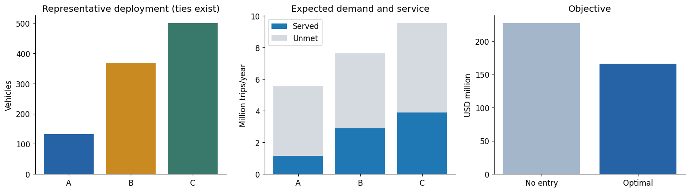

# Large-case baseline experiment

## Question and annual inputs

How does the baseline behave when annual demand lies near city capacity? Three synthetic cities have $M=(577,908,105;770,544,140;963,180,175)$ opportunities/year. Ten equiprobable scenarios draw each city's $p$ from $\{0.002,0.005,0.01,0.02\}$ with seed 2026.

Common inputs: $Q=1,000$, $\bar q=500$, $\kappa=8,760$ trips/vehicle-year, $F=3.5$M USD/city, $K=7,972$ USD/vehicle-year, $c^+=0$, $c^-=10$ USD/trip. Each city's maximum annual capacity is 4.38M trips.

## Main result and tied optima

| Result | Value |
|---|---:|
| Entered cities | A, B, C |
| Representative fleet (A,B,C) | **(132,368,500)** |
| Complete tied set | A=132; B=368–439; C=868−B; **72 allocations** |
| Mean served trips / service rate | 7,932,603 / **34.93%** |
| Capacity utilization | 90.6% |
| Objective / no-entry objective | USD 166,263,859 / 227,117,885 |
| Improvement over no entry | **USD 60,854,026** |

Annual baseline: representative fleet, served versus unmet demand, and objective improvement over no entry.

With $c^+=0$, an extra fully utilized vehicle has expected net value approximately $87,600\Pr(D_c>\kappa q_c)-7,972$. A receives its first 132 vehicles before its marginal value falls below the shared B/C step. Equal marginal values in B and C explain the 72 optima; a single reported fleet vector hides that flexibility.

## Sensitivity and sampling

Sampling stability: sampled mean demand and extra decision cost evaluated on the same original distribution.

At 50 sampled scenarios, different seeds produce different decisions and up to about USD 1.73M extra cost under the common original distribution. At 500, all five tested seeds have zero extra cost. This checks stability under the **assumed ten-point distribution**, not consistency with actual robotaxi demand.

A's entry is fragile: the baseline improves on $(0,500,500)$ by only about USD 392,967. The tested common-entry-cost sweep switches between roughly 3.72M and 3.94M. Mean-demand-optimal allocations incur about 0.39M–8.14M additional cost when evaluated on the ten scenarios. These ranges describe the tested settings, not universal thresholds.

## Code and verification

Run all cells in Colab; setup installs missing NumPy/pandas/SciPy/Matplotlib dependencies. SciPy `milp` uses HiGHS. Trips and currency are scaled internally to millions for numerical stability, then restored for reporting.

- Independent exact dynamic programming evaluates integer fleets and combines city costs under $Q$; small exhaustive checks validate the reference.
- Eight edge cases and MILP–DP agreement checks cover the baseline and sensitivity settings.
- Sweeps change common and city-specific inputs, followed by 50/100/500 scenario samples with five seeds each.
- Export cells produce annual edge-case, common/city sensitivity, and sampling CSV tables and figures.

The probability levels are intentionally near capacity. The parameter-rationale document gives scale references but uses other exploratory probability levels; the actual inputs for this result are the ones above and in the notebook. These are literature-informed synthetic experiments, not calibrated city forecasts.

## Documents and their contents

- **[large_case.pdf](large_case.pdf)** — Annual inputs, exact DP verification, 72 tied optimal allocations, parameter sensitivity, mean-demand comparison, and scenario-sampling stability.

## Code and Colab launch

- **[baseline_largecase.ipynb](baseline_largecase.ipynb)** · [Colab](https://colab.research.google.com/drive/1eLKtC6O0tr65SM1JkziHM24RaPbEDo3_) — Annual MILP + exact DP; tied optima, common/city sensitivity, mean-demand evaluation, and scenario sampling; exports CSVs and plots.

Colab opens the permission-controlled Drive original. The GitHub notebook is a saved snapshot; changes are not automatically synchronized.

---

[Parent guide](../README.md) · [Project overview](../../../../README.md)
