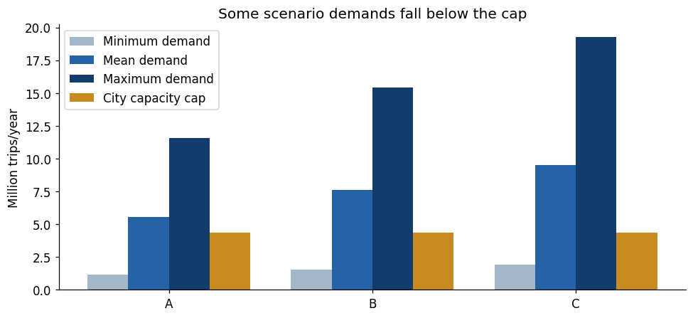
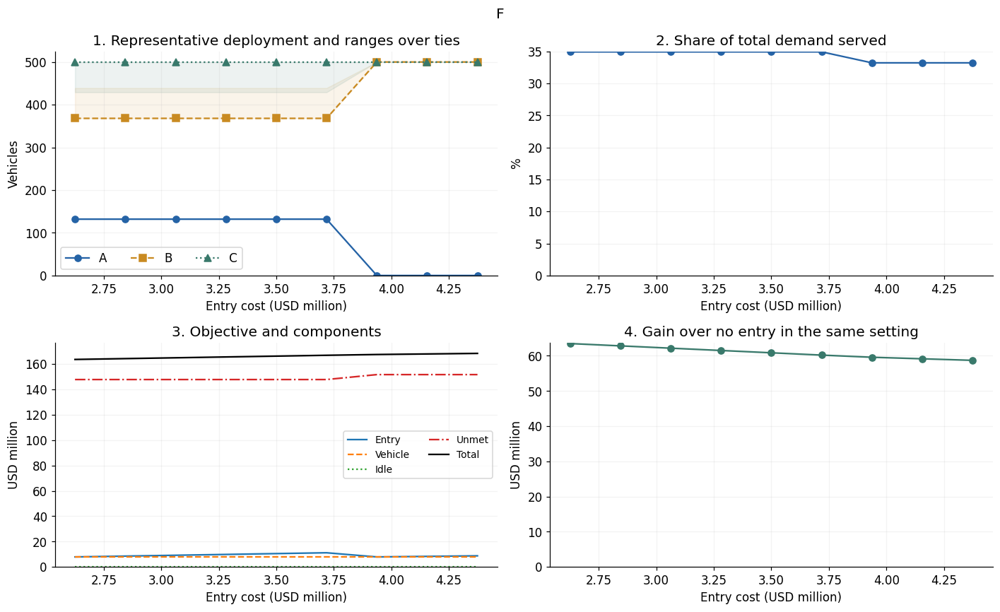

# Large-case baseline numerical experiment

This experiment asks whether the baseline remains correctly implemented at annual scale, whether the chosen inputs expose meaningful entry/capacity trade-offs, and how conclusions depend on cost, demand, capacity, and scenario sampling. It follows the small-case exhaustive checks with an independent dynamic-programming reference.

[Full experimental report](large_case.pdf) · [Notebook](baseline_largecase.ipynb) · **[Run in Colab](https://colab.research.google.com/drive/1eLKtC6O0tr65SM1JkziHM24RaPbEDo3_)**

## Settings and their evidence

The instance has three **synthetic cities**, not three calibrated operating markets. The [parameter-rationale document](../../../../3.%20References/B.%20parameter_rationale_baseline.pdf) distinguishes source observations, published estimates, arithmetic derivations, and experimental assumptions. A source gives a scale reference; it does not validate the resulting input for every city.

| Input | Implemented setting | Basis and limitation |
|---|---|---|
| Annual market opportunities $M$ | A: 577,908,105; B: 770,544,140; C: 963,180,175 | Reference 770,544,140 = reported SFCTA annual TNC trips 38,527,207 / SFMTA 5% mode share; city multipliers 0.75/1/1.25 are designed heterogeneity. Source periods/populations/trip units differ, so this is a proxy, not observed potential demand |
| Productivity $\kappa$ | 8,760 trips/vehicle-year | Rounded 24 daily trips ×365, motivated by reported Waymo weekly trips/fleet totals. Realized throughput is not a measured maximum capacity |
| Total fleet / city cap | $Q=1,000$, $\bar q=500$ | Resource-limit assumptions informed by public fleet scales; not actual city capacity constraints |
| Entry cost $F$ | USD 3.5M per city, paid once | Austin facility project estimates of 0.3M +2.5M, plus an assumed 25% preparation allowance; one facility case is not a calibrated cross-city cost |
| Annual vehicle cost $K$ | USD 7,972/vehicle-year | Selected AAA personal new-vehicle ownership-cost components as a proxy, not measured robotaxi operating cost |
| Surplus / unmet loss | $c^+=0$, $c^-=10$ USD/trip | No additional idle penalty in the base case; unmet loss is a literature-informed contribution-margin setting, not gross fare |
| Choice and scenario design | 10 equiprobable joint scenarios; each city's $p$ drawn from 0.002/0.005/0.01/0.02, seed 2026 | Designed to put demand near capacity. These probabilities are assumptions, not estimates fitted to robotaxi choices |

Entry is charged once and demand/capacity/vehicle costs cover one year. The actual probability levels above differ from exploratory levels in the parameter-rationale PDF; use the notebook and experiment report for the implemented demand matrix. All cities share costs/productivity/caps, so baseline city heterogeneity comes from demand.

## Why demand must straddle capacity

Each city can serve at most $8,760\times500=4.38$M annual trips. The probability at which demand reaches that capacity is about 0.0076, 0.0057, and 0.0045 for A/B/C, inside the chosen probability range.

With the earlier candidate probabilities 0.02/0.1/0.2/0.4, even the smallest demand exceeded maximum capacity. Every deployed vehicle then served its full capacity wherever assigned, suppressing the allocation effects the experiment sought to examine. Reducing probability levels by a factor of ten creates both shortage and idle-capacity scenarios: maximum capacity is exceeded in 5/10, 5/10, and 8/10 scenarios for A/B/C. This makes demand-sensitive allocation an informative model check rather than an artifact of universal shortage.

## Model checks and what they establish

| Question | Experiment / independent check | Conclusion for the model |
|---|---|---|
| Does annual-scale MILP match the formulation? | Independently calculate each city's integer-fleet cost and combine them through an exact dynamic program; check balance, domains, limits, and objective recomputation | Reported MILP–DP checks agree. Internally scaling trips and currency to millions preserves the original model while improving numerical conditioning |
| Do boundary tests remain valid at this scale? | Eight cases cover zero fleet/demand, a prohibited city, zero shortage loss, entry cost above all service value, loose fleet, zero entry cost, and exact demand-capacity balance | Checks are stated as scale-independent properties, rather than copying the small case's numerical expectations |
| Can the same objective support multiple fleet vectors? | Recover and compare the full optimal allocation set | Equal marginal vehicle values can create many tied optima. A change in solver-selected vector need not mean a change in objective or policy quality |
| Does replacing demand by its mean preserve decision quality? | Evaluate tied mean-demand decisions under the same original ten scenarios | Extra cost is about USD 0.39M–8.14M, showing that a deterministic objective alone is not a valid comparison |
| How stable are decisions to scenario samples? | Resample 50/100/500 joint rows with replacement, five seeds each; reevaluate decisions on the original distribution | Distinguishes sampling noise in the training objective from actual quality under a common assumed distribution |

## Sensitivity: mechanisms rather than one optimal fleet

Reoptimize one input at a time. Common sweeps cover $Q,F,K,\kappa,M,p,\bar q,c^+,c^-$ and mean-preserving dispersion $\alpha$; city-specific sweeps alter one city's inputs while holding other cities fixed.

**Entry-cost interpretation.** In the tested grid, A is dropped between common entry costs of about USD 3.72M and 3.94M. Its baseline service benefit only narrowly covers its fixed entry cost. The experiment identifies a bracket between tested values, not an exact universal threshold. Changes in cost and improvement can occur even where the allocation is stable.

| Input / mechanism | What the experiment reveals |
|---|---|
| Market size $M$ versus choice $p$ | Equal proportional changes have the same effect because demand enters only through $D=Mp$. They cannot be separately identified from allocation behavior alone |
| Total fleet $Q$, city cap $\bar q$, productivity $\kappa$ | Determine whether scarcity is system-wide, city-specific, or demand-dependent. Relaxing one limit may change the allocation only when another bottleneck permits it |
| Common versus city-specific costs | Common $F/K$ changes can mainly alter economic performance; city-specific penalties can resolve otherwise tied B/C allocations |
| Idle penalty $c^+$ | An unchanged vector need not imply no effect: surplus-capacity cost can rise while decisions remain in the same optimal region |
| Dispersion $\alpha$ at fixed city means | Isolates uncertainty from demand scale; changing variability can change entry, ties, and operating costs even without changing mean demand |

At the reference inputs there are 72 optimal allocations. All have A=132 and B+C=868, with B=368–439 and C=429–500. This reflects equal marginal values on B/C's discrete-demand cost steps, not numerical failure. Shading shows the range across tied optima at tested points, **not** a confidence interval; a representative line alone can hide this flexibility.

## Sampling stability under a common distribution

At 50 scenarios, seeds produce different allocations and up to about USD 1.73M extra cost under the common original distribution. At 500, all five tested seeds attain zero extra cost. Larger samples stabilize the tested decisions here, but this resampling experiment does not estimate an actual city demand distribution or establish a universal sample-size requirement.

## Reference outcome, briefly

At the stated inputs, all three cities are entered; one representative fleet is **(132,368,500)** with objective **USD 166,263,859**. Expected service is 7,932,603 trips (34.93% of demand), and improvement over no entry is about USD 60.85M. The full tied solution set and common-distribution comparisons are more informative than treating this one fleet vector as the experiment's conclusion.

## Code and reproduction

Open **[Colab](https://colab.research.google.com/drive/1eLKtC6O0tr65SM1JkziHM24RaPbEDo3_)** and run cells in order: input/demand-capacity checks → MILP and independent DP → boundary tests → common and city-specific sensitivity → mean-demand comparison → repeated scenario samples → export.

The [saved notebook](baseline_largecase.ipynb) uses NumPy, pandas, SciPy `milp`/HiGHS, and Matplotlib; setup installs missing packages. Inspect verification tables, tie ranges, and common-evaluation costs alongside plots. Export cells save edge-case, common/city sensitivity, and sampling CSV tables. Colab opens the Drive original; the GitHub snapshot is not automatically synchronized.

[Experiment overview](../README.md) · [Baseline formulation](../../1%29%20baseline/README.md) · [Parameter evidence and assumptions](../../../../3.%20References/B.%20parameter_rationale_baseline.pdf)
