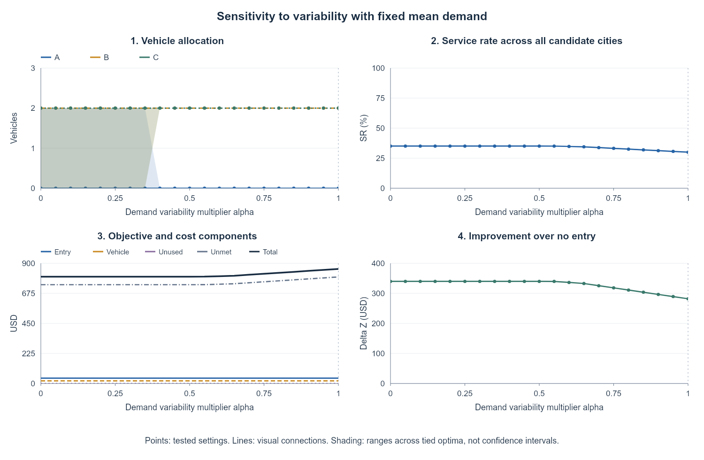
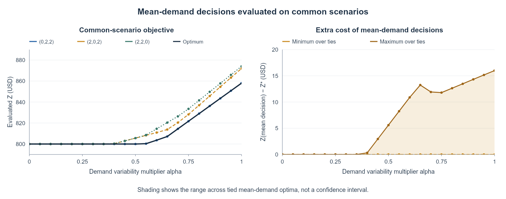

# Small-case baseline numerical experiment

This experiment checks whether the baseline's equations, implementation, and economic interpretation agree in an instance small enough to inspect independently. It also tests how entry costs, capacity limits, and demand variation change decisions and performance.

[Full experimental report](small_case.pdf) · [Notebook](baseline_smallcase.ipynb) · **[Run in Colab](https://colab.research.google.com/drive/1xJvXZokBwrCa2vabDtKB1izIU3fAevtx)**

## Settings and why they were chosen

All values are **deliberately designed synthetic inputs**, not observed city data or literature-calibrated coefficients. Small integers make exhaustive verification and direct cost comparisons possible. Only market size differs by city, isolating its role from cost and productivity differences.

| Input | Setting | Design rationale |
|---|---|---|
| Candidates and market sizes | A, B, C; $M=(80,100,120)$ opportunities/year | Simple heterogeneous market sizes with otherwise identical city conditions |
| Joint demand scenarios | 10 fixed rows, equal scenario probabilities; $p$ values from 0.05, 0.2, 0.5, 0.8 | Include low/high demand and mixed city outcomes; the cities have the same marginal choice distribution and mean $p=0.38$ |
| Capacity | $\kappa=10$ trips/vehicle-year, city cap $\bar q=2$, total fleet $Q=4$ | Scarce capacity forces a choice between concentrating vehicles and paying to enter another city |
| Entry and vehicle costs | $F=20$ per city; $K=5$ per vehicle-year | Transparent fixed-cost trade-off that can be checked by hand |
| Surplus / shortage costs | $c^+=0$, $c^-=10$ per trip | Start without an extra idle penalty; introduce one in sensitivity analysis |
| Evaluation period | One year after entry | Charge entry once and align demand, service capacity, and annual vehicle costs |

Demand is $D_c^s=M_cp_c^s$. Choice probability $p_c^s$ is distinct from the scenario probability 0.1. Each matrix row is one joint scenario, not a time step or a request to expand all combinations. Entry and fleet are chosen once; city capacity cannot be transferred after demand is observed. Unentered-city demand still contributes to unmet-demand loss.

## Model checks and what they establish

| Question | Check | Finding and implication |
|---|---|---|
| Does the MILP solve the written model? | Independently enumerate all **60 feasible $(y,q)$ pairs** and recompute costs | The optimum agrees; verification includes decisions using fewer than four vehicles, not just full-fleet alternatives |
| Are decisions and outcomes feasible? | Check integer/binary domains, city/total limits, nonnegativity, and scenario capacity balance | Reported checks pass; compute service and surplus/shortage directly from demand and capacity |
| Do boundary cases behave correctly? | E1–E8: zero fleet, zero demand, a prohibited city, zero shortage loss, prohibitive entry cost, loose fleet, zero entry cost, and exact demand-capacity balance | No service incentive yields no deployment; city caps can leave vehicles unused; zero entry cost may permit tied entry indicators |
| Does the entry decision reflect fixed-cost economics? | Compare service gain with the added entry cost | A three-city allocation serves 0.8 more trips, worth 8, but costs 20 more to enter: extra service need not justify expansion |
| Is an unchanged representative allocation evidence of insensitivity? | Track all tied optima and operating performance across sweeps | No: uncertainty and penalty changes can alter costs or the tied solution set before the representative vector changes |

For a fixed decision, use

```math
T_c^s=\min(D_c^s,\kappa_cq_c),\quad
O_c^s=(\kappa_cq_c-D_c^s)_+,\quad
U_c^s=(D_c^s-\kappa_cq_c)_+.
```

The objective is entry + annual vehicle cost + expected surplus/shortage cost. These checks verify this specified implementation; they do not establish that the assumed demand describes an actual market.

## Sensitivity: what does the model respond to?

Each sweep changes one input and reoptimizes. Inspect allocation, service rate, objective components, and improvement over no entry together. Improvement is recalculated against the no-entry cost under the **same modified inputs**.


**Entry-cost mechanism.** The extra city's service contribution is 8. At common $F=8$, the two- and three-city alternatives tie; below that value a three-city solution is preferred, while above it the two-city alternative wins in this comparison. This ties an observed switching point to the objective's fixed-cost structure.

| Input varied | What the experiment reveals |
|---|---|
| Total fleet $Q$ (0–8) | Fleet is an upper bound, not a deployment requirement. Beyond six vehicles, the three city caps of two prevent further gains |
| Productivity $\kappa$ (5–20) | Higher productivity can make a dispersed, three-city allocation worthwhile. With $c^+=0$, increasing capacity cannot worsen the best objective for fixed demand/costs |
| A's market size $M_A$ (0.5–2 times baseline) | Separates the effect of one city's demand scale; changing $M_A$ changes both its mean and variation |
| Extra idle penalty $c^+$ (0–20) | Costs can rise before allocation changes. The compared cost lines $858+5.8c^+$ and $870+5c^+$ meet at $c^+=15$, revealing a switch missed by testing only 0, 2, and 5 |
| Demand dispersion $\alpha$ (0–1) | $p^s(\alpha)=\bar p+\alpha(p^s-\bar p)$ preserves means and isolates variation; no new random samples are drawn |



**Uncertainty mechanism.** At zero dispersion three concentrated allocations tie; at the original dispersion only the B/C allocation remains optimal. Cost changes from 800 to 858 even though the chosen representative vector can stay the same. Mean demand alone therefore hides scenario-specific idle capacity and shortage.



**Comparable evaluation.** Optimize with mean demand, then evaluate every tied mean-demand allocation on the original ten scenarios. Compare those evaluated costs with the stochastic optimum. Comparing the deterministic objective 800 directly with 858 would mix different evaluation distributions.

## Reference outcome, briefly

At the stated baseline inputs, the unique optimum enters B and C with $q=(0,2,2)$ and cost **858** (40 entry +20 vehicle +798 unmet loss). Service is 34.2 of 114 expected trips (30%); improvement over no entry is 282. These values are a reproducible reference for the checks above, not an estimated real-city deployment recommendation.

## Code and reproduction

Open **[Colab](https://colab.research.google.com/drive/1xJvXZokBwrCa2vabDtKB1izIU3fAevtx)** and run cells in order: baseline MILP → independent enumeration/feasibility checks → eight boundary tests → sensitivity sweeps → common-scenario mean-demand comparison. Inspect the check tables alongside the allocation, cost, and service plots.

The [saved notebook](baseline_smallcase.ipynb) uses NumPy, pandas, SciPy `milp`/HiGHS, and Matplotlib; setup installs missing dependencies. No external demand file or commercial solver license is needed. Plot shading denotes ranges across tied optimal allocations, not confidence intervals. Colab opens the Drive original; the GitHub snapshot is not automatically synchronized.

[Experiment overview](../README.md) · [Baseline formulation](../../1%29%20baseline/README.md) · [Parameter evidence and assumptions](../../../../3.%20References/B.%20parameter_rationale_baseline.pdf)
