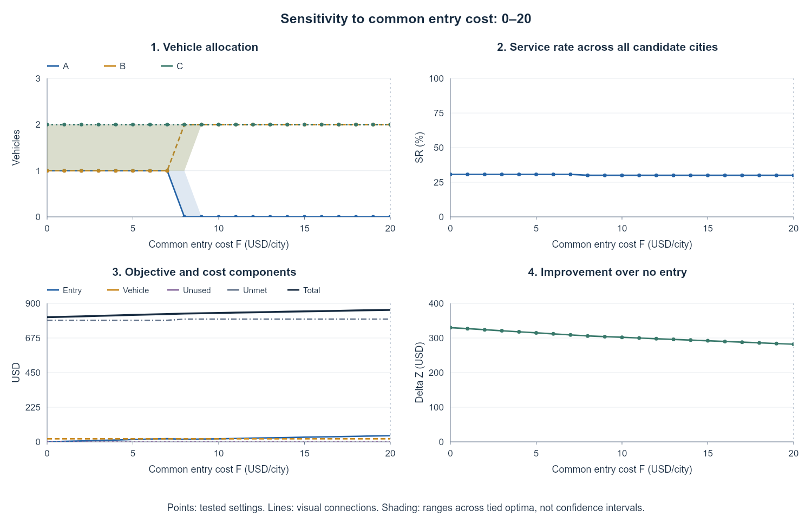

# Small-case baseline experiment

## Question and inputs

Does the MILP implement the baseline correctly, and when does entry in a third city become worthwhile? The instance uses 3 cities, 10 manually specified equiprobable joint scenarios, $Q=4$, and a cap of 2 vehicles per city.

| Input | A | B | C |
|---|---:|---:|---:|
| Annual opportunities $M_c$ | 80 | 100 | 120 |
| Trips per vehicle $\kappa_c$ | 10 | 10 | 10 |
| Entry cost $F_c$ | 20 | 20 | 20 |
| Annual vehicle cost $K_c$ | 5 | 5 | 5 |

$c^+=0$, $c^-=10$, and $D_c^s=M_cp_c^s$. Each row is one joint scenario; the notebook does not expand them into all city-level combinations.

## Main result

| Result | Value |
|---|---:|
| Entry $y$ / fleet $q$ | (0,1,1) / (0,2,2) |
| Expected demand / served trips | 114 / 34.2 |
| Service / capacity utilization | 30.0% / 85.5% |
| Expected unmet / unused capacity | 79.8 / 5.8 |
| Cost: entry + fleet + unmet | 40 + 20 + 798 = **858** |
| No-entry objective / improvement | 1,140 / **282** |

Small-case service and allocation comparison: the two-city optimum costs 858; three-city alternatives cost at least 870.

Entering all three cities with $(1,1,2)$ serves 0.8 extra trips, worth 8, but adds 20 in entry cost. Its objective is 870, versus 858 for $(0,2,2)$. The result is verified against **all 60 feasible entry/fleet pairs**, including allocations using fewer than four vehicles.

## What changes the decision?

Entry-cost sensitivity: the third-city service gain is worth 8, creating the switch at common F=8.

The common-entry-cost switch is $F=8$: below it three-city allocations are preferred; at it two- and three-city alternatives tie; above it the two-city solution wins locally. Increasing total fleet beyond 6 cannot help because each city is capped at 2. Mean-demand optima can perform differently when evaluated on the original ten scenarios.

## Code: how to reproduce and what to inspect

Run the notebook from top to bottom in Colab. It uses NumPy, pandas, SciPy `milp`/HiGHS, and Matplotlib; setup cells install missing dependencies. No external demand file or solver license is required.

1. Build the demand matrix and solve the MILP; inspect the allocation, scenario outcomes, and cost breakdown.
2. Independently enumerate feasible decisions; check integrality, limits, balance, and recalculated objective.
3. Run E1–E8 boundary tests, including zero vehicles, zero demand, prohibitive entry cost, and exact demand-capacity balance.
4. Reoptimize sweeps in $Q,F,\kappa,M_A,c^+$ and demand dispersion; compare mean-demand decisions on common scenarios.

Plots show representative allocations and ranges across tied optima; the shaded ranges are not statistical confidence intervals. Results establish implementation behavior for this synthetic instance.

## Documents and their contents

- **[small_case.pdf](small_case.pdf)** — Synthetic inputs, 60-decision exhaustive verification, cost decomposition, E1–E8 tests, entry-cost switching point, and uncertainty sensitivity.

## Code and Colab launch

- **[baseline_smallcase.ipynb](baseline_smallcase.ipynb)** · [Colab](https://colab.research.google.com/drive/1xJvXZokBwrCa2vabDtKB1izIU3fAevtx) — Small MILP + 60-pair exhaustive reference; edge tests, sensitivity, and common-scenario mean-demand comparison.

Colab opens the permission-controlled Drive original. The GitHub notebook is a saved snapshot; changes are not automatically synchronized.

---

[Parent guide](../README.md) · [Project overview](../../../../README.md)
