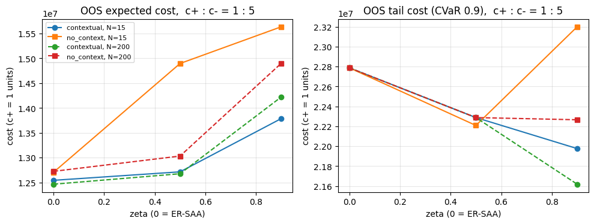
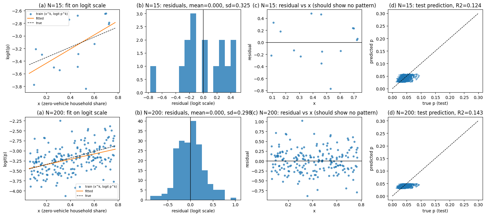

# ER-DRO model and experiments

## What this model adds

City characteristics generate demand scenarios through a learned logit model. The optimizer chooses entry and fleet before observing demand and minimizes entry cost plus a CVaR penalty. Context is exogenous: demand does **not** change with the chosen fleet in this version.

$$
p_c^s=\sigma(\hat\beta_0+\hat\beta_1x_c+\hat\varepsilon_s),\quad
D_c^s=M_cp_c^s,\quad \sigma(z)=(1+e^{-z})^{-1}
$$

$$
\min_{y,q,\tau,w,O,U}\sum_c F_cy_c+\tau+
\frac{1}{N(1-\zeta)}\sum_{s=1}^Nw_s
$$

$$
w_s\ge\sum_c(c_c^+O_c^s+c_c^-U_c^s)-\tau,\quad w_s\ge0,
\qquad\kappa_cq_c-D_c^s=O_c^s-U_c^s.
$$

The baseline city/fleet constraints still apply: $0\le q_c\le\bar q_cy_c$, $\sum_cq_c\le Q$, binary $y$, integer $q$, and nonnegative $O,U$. Residuals are $\hat\varepsilon_k=\operatorname{logit}(p^k)-\hat\beta_0-\hat\beta_1x^k$; one residual generates one joint scenario, so $|S|=N$.

At $\zeta=0$ the cost is the sample average (ER-SAA). Larger $\zeta$ focuses on the worst scenario costs, equivalently allowing weights $0\le\pi_s\le1/[N(1-\zeta)]$ summing to one. This changes scenario weights, not scenario locations.

## Experiment design

- **Context:** actual ACS zero-vehicle household shares for 18 candidate-city county proxies. Household totals ×10 supply toy $M$ values.
- **Synthetic learning:** $\beta_0=-3.5$, $\beta_1=0.8$, normal logit error with standard deviation 0.3; train with $N=15,200$.
- **Decisions:** city cap 150, capacity 8,760 trips/vehicle-year, fleet set to about 60% of expected demand (267 vehicles in the reported case).
- **Comparisons:** contextual ER-SAA, contextual ER-DRO, no-context benchmark, and a city-count-budget variant.
- **Evaluation:** 1,000 separate true-model scenarios; report mean cost and the mean of the worst 10% (OOS CVaR at 0.9).

## Main result: expected cost versus tail protection

| $N=200,c^+=1,c^-=5$ | $\zeta=0$ | $\zeta=0.5$ | $\zeta=0.9$ |
|---|---:|---:|---:|
| OOS mean cost (million normalized cost units) | 12.46 | 12.67 | 14.22 |
| OOS tail cost (million normalized cost units) | 22.79 | 22.29 | 21.62 |
| Cities entered | 6 | 5 | 3 |

OOS mean and worst-10% cost versus risk parameter, with c+=1 and c-=5; larger risk aversion trades average cost for tail protection.

Greater conservatism lowers tail cost here while raising average cost. Context improves the no-context comparison, but DRO does not guarantee improvement in every OOS metric: with $N=15$, no-context tail cost can worsen as $\zeta$ increases. The experiment uses synthetic choices, not observed robotaxi demand.

## Learning and solution checks

Logit fit and residual diagnostics for N=15 and N=200; inspect signal strength and whether residual reuse is plausible.

With $N=200$, estimated slope 0.665 and residual standard deviation 0.298 are near the toy truth 0.8 and 0.3. Test $R^2\approx0.143$ reflects weak explanatory signal; residual plots are diagnostic evidence, not proof of independence in real data.

The optional L-shaped comparison stops at 1% relative tolerance. Reported feasible costs are 0.43–0.65% above the extensive form, so it is not an exact-solution equality check. The extensive form was faster for these toy instances.

## Code, outputs, and document versions

Run the notebook top to bottom in Colab. It uses NumPy, SciPy/HiGHS, Matplotlib, and pandas in the diagnostic/export cells. The setup installs SciPy and Matplotlib; pandas is available in the usual Colab environment. `RUN_COMPARE=True` enables the optional decomposition comparison. Later sensitivity cells solve roughly 130 models and take longer than the base loop.

Outputs include `table2_main_results.csv`, `table3_budget.csv`, `table4_sensitivity.csv`, regression diagnostics, OOS-vs-risk plots, and sensitivity plots. Fit diagnostics, decisions, and OOS costs should all be inspected; an in-sample objective alone does not measure generalization.

Read **revised** for the two-stage formulation and logit residuals. **Draft** retains a separate $K_cq_c$ term and earlier residual notation. The revised version omits separate vehicle cost; its coefficient-absorption identity is exact for expectation under the stated adjustment but only approximate for general CVaR ($\zeta>0$), as its derivation notes. Do not treat the revised cost scale as identical to the baseline.

## Documents and their contents

- **[ER-DRO(draft1).pdf](ER-DRO%28draft1%29.pdf)** — Earlier CVaR formulation retaining separate vehicle cost and pre-revision residual notation; compare with revised before using equations.
- **[ER-DRO(revised).pdf](ER-DRO%28revised%29.pdf)** — Two-stage CVaR MILP, logit residual scenarios, toy-data training/OOS design, solution comparison, and risk/sensitivity results.

## Code and Colab launch

- **[ER-DRO(non decision-dependent).ipynb](ER-DRO%28non%20decision-dependent%29.ipynb)** · [Colab](https://colab.research.google.com/drive/1dz5QtiAnYBBmKfDLi95xfjFirqg2fcAT) — Logit learning → residual scenarios → ER-SAA/ER-DRO/no-context decisions → independent OOS scoring; diagnostics, optional decomposition, and CSV exports.

Colab opens the permission-controlled Drive original. The GitHub notebook is a saved snapshot; changes are not automatically synchronized.

---

[Parent guide](../README.md) · [Project overview](../../README.md)
