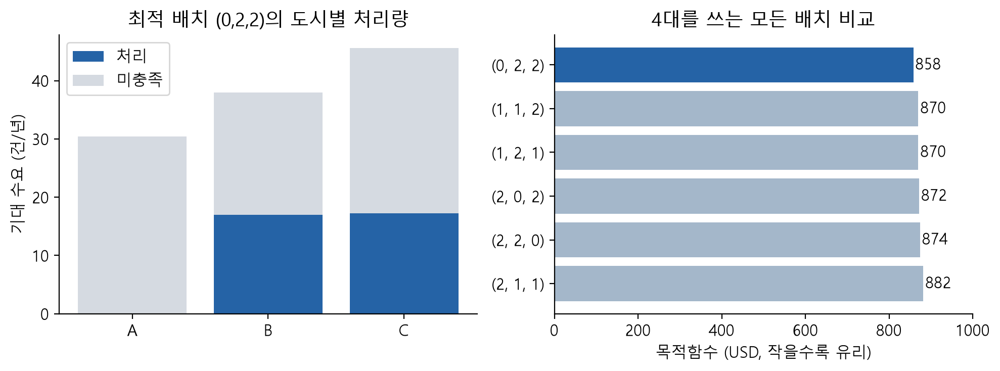

# Baseline 실험: 한글 보고서·코드

## 작은 사례: 입력·모형·결과

3개 도시의 $M=(80,100,120)$, 차량당 용량 10, 도시 상한 2, 전체 차량 4를 사용합니다. 10개 공동 시나리오를 동일 확률로 평가하며 $F=20,K=5,c^+=0,c^-=10$입니다.

```math
\min \sum_cF_cy_c+\sum_cK_cq_c+
\frac1{10}\sum_{s,c}(c_c^+O_c^s+c_c^-U_c^s),\qquad
\kappa_cq_c-M_cp_c^s=O_c^s-U_c^s.
```

| 결과 | Small case | Large case 한글 코드 |
|---|---|---|
| 대표 배치 | **(0,2,2)** | **(132,368,500)** |
| 목적값 | **858 USD** | **166,263,859 USD** |
| 처리율 / 용량 활용률 | 30.0% / 85.5% | 34.93% / 90.6% |
| 미진입 대비 개선 | 282 USD | 60,854,026 USD |
| 독립 검증 | 60개 전수계산, 유일해 | 동적계획법, 동률 배치 72개 |



작은 사례의 도시별 처리·미충족과 배치별 목적값: (0,2,2)가 858로 최적입니다.

Small case에서 $(1,1,2)$는 0.8건을 더 처리하지만 공헌이익 8보다 추가 진입비 20이 큽니다. 그래서 목적값은 870으로 오르고 B·C만 진입하는 858이 더 유리합니다.


진입비 민감도: 추가 처리의 가치 8과 진입비를 비교하며 F=8에서 배치가 전환됩니다.

공통 진입비 $F=8$에서 두 도시와 세 도시 배치가 동률이며, 그 아래에서는 세 도시 진입이 유리합니다. 음영은 동률 최적 배치의 범위로 신뢰구간이 아닙니다.

## 두 코드의 차이와 실행 방법

- **Small case:** 위 입력으로 MILP·전수계산 대조, E1–E8 경계검사, $Q,F,\kappa,M_A,c^+$·수요변동성 민감도, 평균수요 결정의 공통 시나리오 평가를 수행합니다.
- **Large case:** $Q=1,000$, 도시 상한 500, $\kappa=8,760$, 도시별 연간 $M$과 seed 2026의 무작위 $p$를 사용합니다. A=132, B+C=868인 72개 동률 해를 찾고, 독립 DP 검증 및 50·100·500개 시나리오×5개 시드 실험을 수행합니다.
- **실행:** Colab에서 위에서 아래로 모두 실행합니다. NumPy·pandas·SciPy/HiGHS·Matplotlib를 사용하고 준비 셀에서 필요한 패키지를 설치합니다. 외부 수요 파일이나 유료 솔버는 필요하지 않습니다.
- **출력:** 배치·비용·처리율 표와 민감도 그래프. Large-case export 셀에서는 경계검사·민감도·표본실험 CSV도 저장합니다.

이 폴더의 PDF·그림은 **small case** 결과입니다. Large case 상세 PDF와 그림은 영문 large_case에서 확인하세요. 실제 도시별 최적 차량 수를 추정한 결과가 아닙니다.

## 문서와 핵심 내용

- **[small_case(한글).pdf](small_case%28%ED%95%9C%EA%B8%80%29.pdf)** — 입력·비용 분해·60개 전수검증·경계검사·민감도·평균수요 결정 비교를 정리한 small-case 보고서입니다.


## 코드와 Colab 실행

- **[baseline_largecase(한글).ipynb](baseline_largecase%28%ED%95%9C%EA%B8%80%29.ipynb)** · [Colab](https://colab.research.google.com/drive/1YsArFdKTv3LFnlhcAC__o0PlrfRD-eEx) — 연간 입력 MILP·독립 DP, 72개 동률 해, 공통·도시별 민감도, 시나리오 표본실험과 CSV·그래프 출력.
- **[baseline_smallcase(한글).ipynb](baseline_smallcase%28%ED%95%9C%EA%B8%80%29.ipynb)** · [Colab](https://colab.research.google.com/drive/1VT-cDsVp_YqmNhzPgUUk2LuJHBpc97tK) — 작은 사례 MILP·60개 전수계산 대조, E1–E8, 민감도·평균수요 비교 및 그래프 출력.

Colab은 접근 권한이 있는 Drive 원본을 엽니다. GitHub 파일은 저장된 사본이며 자동 동기화되지 않습니다.

---

[상위 안내](../README.md) · [전체 연구 안내](../../../../../README.md)
