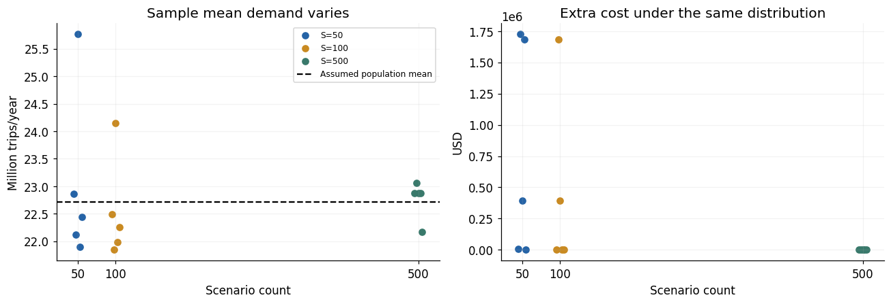

# Baseline numerical experiments

These experiments test the baseline's implementation and explain its behavior before moving to learned, contextual demand. The sequence is **small-instance verification → annual-scale validation → sensitivity and uncertainty checks**. Final city/fleet choices serve as reproducible reference outputs; the questions are whether the model is implemented correctly and how its assumptions drive decisions.

## Why two cases?

| Design question | Small case | Annual large case |
|---|---|---|
| Main purpose | Make the formulation independently inspectable and isolate entry/capacity economics | Check the same formulation at annual scale and examine demand-sensitive allocation, tied optima, and sampling stability |
| Input basis | Deliberately simple synthetic values; not calibrated data | Literature-informed scale proxies plus explicit synthetic assumptions; not calibrated actual cities |
| Candidates / joint scenarios | 3 / 10 fixed, equiprobable rows | 3 / 10 equiprobable rows, probabilities drawn with seed 2026 |
| Demand design | $M=(80,100,120)$; manually specified choice probabilities with identical city marginals | City market sizes at 0.75/1/1.25 of a reference scale; choice levels selected so demand straddles maximum capacity |
| Capacity | $Q=4$, city cap 2, productivity 10 | $Q=1,000$, city cap 500, productivity 8,760 trips/vehicle-year |
| Independent reference | Enumerate all 60 feasible entry/fleet pairs | Exact city-cost dynamic program, supported by small exhaustive checks |
| Additional questions | Boundary behavior, exact switching points, fixed-mean dispersion, mean-demand ties | Common versus city-specific sensitivity, full tied-optimum ranges, repeated scenario samples |

For the annual case, the [parameter-rationale document](../../../3.%20References/B.%20parameter_rationale_baseline.pdf) distinguishes observations, published estimates, arithmetic derivations, and assumptions. Capacity, market size, entry cost, and vehicle-cost proxies each have scope limitations. The small case uses transparent numbers for verification; it does not claim the annual inputs' empirical scale. Actual implemented probability levels are documented in each case, rather than inferred from the rationale PDF's exploratory ranges.

## Shared model and evaluation rules

Both experiments use the [baseline formulation](../1%29%20baseline/README.md): entry $y_c$ and integer fleet $q_c$ are common to all scenarios; capacity cannot move between cities after demand is observed. Costs combine one-time entry, annual vehicle cost, and expected surplus/shortage penalties.

```math
D_c^s=M_cp_c^s,\quad
T_c^s=\min(D_c^s,\kappa_cq_c),\quad
O_c^s=(\kappa_cq_c-D_c^s)_+,\quad
U_c^s=(D_c^s-\kappa_cq_c)_+.
```

```math
Z(y,q)=\sum_c(F_cy_c+K_cq_c)+\frac1{|S|}\sum_{s,c}(c_c^+O_c^s+c_c^-U_c^s),
\qquad \Delta Z=Z_{\mathrm{no\ entry}}-Z(y,q).
```

Choice probabilities $p_c^s$ differ from scenario occurrence probabilities. Unentered-city demand remains unmet. Service rate compares expected served trips with expected demand; utilization compares served trips with deployed capacity. Improvement over no entry must be recalculated using each modified setting's own demand and costs.

## What the experiments establish

| Question to check | How it is tested | Main lesson |
|---|---|---|
| Does the code match the equations? | Independent optimization reference plus objective, balance, integrality, and resource-limit checks | Reported MILP/reference checks agree for the tested instances |
| Do constraints work at boundaries? | Eight edge cases in each case; annual tests use properties valid at their own scale | Zero demand, no service incentive, prohibitive entry costs, and binding city caps give interpretable behavior |
| When is another city worth entering? | Compare additional served-trip contribution with added fixed cost; sweep entry cost | More service need not pay for expansion; in the small case the extra contribution is 8 versus entry cost 20 |
| What do stable or changing allocations mean? | Inspect performance and all tied solutions, not only one solver-selected vector | The same vector can hide changing costs/ties; different vectors can have the same objective |
| Does uncertainty change the conclusion? | Vary dispersion at fixed means and evaluate mean-demand choices on common scenarios | Deterministic objective values alone are not comparable stochastic performance measures |
| Are conclusions stable to scenario samples? | Annual 50/100/500 samples with five seeds, evaluated on the original distribution | Sampling stability must be distinguished from empirical demand validation |

## Sensitivity and uncertainty: representative checks


**Small case — an interpretable switch.** Two- and three-city alternatives tie at common entry cost $F=8$. The switch can be explained directly by the extra service contribution, providing a check on the objective's economic logic. Other sweeps vary fleet, productivity, one city's market size, idle penalty, and fixed-mean dispersion; some change performance or tied optima before the representative allocation changes.



**Annual case — common-distribution stability.** With 50 sampled scenarios, some seeds produce additional evaluated cost up to about USD 1.73M; at 500, all five tested seeds have zero additional cost. This concerns the assumed ten-point distribution, not the accuracy of a real-city demand forecast. Annual sensitivity also shows how equal marginal vehicle values generate 72 tied allocations and how city-specific costs can resolve them.

The [small-case guide](small_case/README.md) and [annual-case guide](large_case/README.md) provide the full settings, input rationale, sensitivity mechanisms, and figure interpretations. Shaded fleet ranges are ranges across tied optima, not confidence intervals; grid-based switches are brackets unless separately derived exactly.

## Reference outputs, briefly

The small reference instance has a unique fleet $(0,2,2)$ with cost 858. The annual instance has representative fleet $(132,368,500)$ with cost about USD 166.264M and 72 tied allocations. They anchor reproduction; they are not calibrated deployment recommendations or comparable costs across two differently scaled instances.

## Reports, code, and Colab

| Case | Report and detailed interpretation | Saved code | Execute |
|---|---|---|---|
| Small | [Report](small_case/small_case.pdf) · [Experiment guide](small_case/README.md) | [baseline_smallcase.ipynb](small_case/baseline_smallcase.ipynb) | [Run in Colab](https://colab.research.google.com/drive/1xJvXZokBwrCa2vabDtKB1izIU3fAevtx) |
| Annual large | [Report](large_case/large_case.pdf) · [Experiment guide](large_case/README.md) | [baseline_largecase.ipynb](large_case/baseline_largecase.ipynb) | [Run in Colab](https://colab.research.google.com/drive/1eLKtC6O0tr65SM1JkziHM24RaPbEDo3_) |

Run cells top to bottom: setup/inputs → baseline and independent reference → boundary checks → sensitivity → uncertainty comparisons. The annual notebook adds repeated sampling and CSV exports. Both use SciPy `milp`/HiGHS with NumPy, pandas, and Matplotlib. Colab opens the Drive original; GitHub notebooks are saved snapshots and do not automatically synchronize.

These are baseline experiments with specified exogenous demand scenarios. Learning context-dependent demand and testing DRO's mean/tail trade-off are covered separately in the [current ER-DRO overview](../../README.md).

[Baseline overview](../README.md) · [Project overview](../../../README.md)
