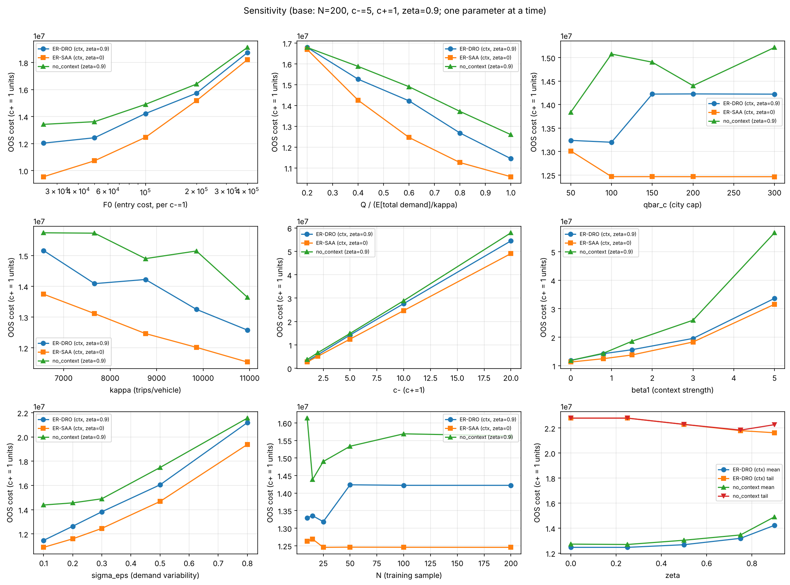

# ER-DRO model and experiments

## File and folder guide

| File / folder | What it contains |
|---|---|
| [ER-DRO(revised).pdf](ER-DRO%28revised%29.pdf) | Current reference: two-stage ER-DRO equations, logit residual scenarios, synthetic experiment design/results, and planned real-data application |
| [ER-DRO(draft1).pdf](ER-DRO%28draft1%29.pdf) | Earlier formulation retaining separate vehicle cost and earlier residual notation; use revised for the current model |
| [ER-DRO(non decision-dependent).ipynb](ER-DRO%28non%20decision-dependent%29.ipynb) | Executable learning → scenarios → ER-SAA/ER-DRO/no-context comparison → independent evaluation; optional solution-method comparison and sensitivity exports |
| [figures/](figures/) | Regression/residual diagnostics, OOS mean-versus-tail cost comparisons, and sensitivity plots used below |

**[Open the ER-DRO notebook in Colab](https://colab.research.google.com/drive/1dz5QtiAnYBBmKfDLi95xfjFirqg2fcAT)** — run cells top to bottom; set `RUN_COMPARE=True` for the optional extensive-form/L-shaped comparison. Colab opens the Drive original; the GitHub notebook is a saved snapshot and does not automatically synchronize.

## Two-stage ER-DRO model

Following [ER-DRO(revised).pdf](ER-DRO%28revised%29.pdf), the model chooses city entry and fleet allocation before demand is known. It minimizes entry cost plus CVaR of the scenario-dependent surplus/shortage cost. Demand is exogenous to these decisions in this version.

### Stage 1: city entry and fleet allocation

```math
\begin{aligned}
\min_{y,q}\quad &\sum_{c\in C}F_cy_c+\mathcal R_\zeta(q)\\
\text{s.t.}\quad &0\le q_c\le\bar q_cy_c &&\forall c\in C,\\
&\sum_{c\in C}q_c\le Q,\\
&y_c\in\{0,1\},\quad q_c\in\mathbb Z_{\ge0} &&\forall c\in C.
\end{aligned}
```

$y_c$ selects a city and $q_c$ allocates vehicles; both are shared across scenarios. $F_c$ is entry cost, $\bar q_c$ is the city fleet cap, and $Q$ is total available fleet. The risk term is

```math
\mathcal R_\zeta(q)=\min_{\tau\in\mathbb R}
\left\{\tau+\frac1{N(1-\zeta)}\sum_{s=1}^N[H(q,D^s)-\tau]_+\right\},
\qquad 0\le\zeta<1.
```

### Stage 2: surplus capacity and unmet demand

For fixed fleet $q$ and scenario demand $D^s$, the recourse problem is

```math
\begin{aligned}
H(q,D^s)=\min_{O^s,U^s}\quad
&\sum_{c\in C}(c_c^+O_c^s+c_c^-U_c^s)\\
\text{s.t.}\quad
&\kappa_cq_c-D_c^s=O_c^s-U_c^s &&\forall c\in C,\\
&O_c^s,U_c^s\ge0 &&\forall c\in C.
\end{aligned}
```

$\kappa_c$ is service capacity per vehicle, while $c_c^+$ and $c_c^-$ price unused capacity and unmet demand. Recourse separates by scenario and city. The optimal surplus and shortage are:

```math
\begin{aligned}
O_c^s &= \left(\kappa_c q_c-D_c^s\right)^{+},\\
U_c^s &= \left(D_c^s-\kappa_c q_c\right)^{+}.
\end{aligned}
```

The superscript plus denotes the positive part (the larger of the expression and zero).

Vehicles are not reallocated across cities after observing demand. The extensive-form MILP linearizes the risk term using $w^s\ge H(q,D^s)-\tau$, $w^s\ge0$, and embeds each scenario's recourse constraints.

### Contextual demand scenarios

```math
\hat\varepsilon^k=\ln\left(\frac{p^k}{1-p^k}\right)-\hat\beta_0-\hat\beta_1x^k,
\qquad
p_c^s=\sigma(\hat\beta_0+\hat\beta_1x_c+\hat\varepsilon^s),
\qquad D_c^s=M_cp_c^s,
\qquad \sigma(z)=\frac1{1+e^{-z}}.
```

Fit the logit-scale regression from observations $(x^k,p^k)$, then attach each empirical residual to the candidate city's context $x_c$. Market size $M_c$ is fixed, and one residual defines one joint scenario, so the training sample size equals the scenario count $N$. All demand scenarios are computed before optimization.

The revised model omits a separate vehicle-cost term $K_cq_c$; its cost-coefficient interpretation is discussed in the revised document and the version notes below.

## What this model adds

Compared with the baseline's specified choice scenarios, ER-DRO **learns context-dependent demand through logit regression and empirical residuals**, then **reweights the fixed scenarios through a CVaR-type ambiguity set**. At $\zeta=0$ it reduces to ER-SAA; larger $\zeta$ emphasizes high-cost outcomes. It supports studying the value of context and the expected-cost/tail-risk trade-off, while retaining decision-independent demand.

## Experiment design

- **Context:** actual ACS zero-vehicle household shares for 18 candidate-city county proxies. Household totals ×10 supply toy $M$ values.
- **Synthetic learning:** $\beta_0=-3.5$, $\beta_1=0.8$, normal logit error with standard deviation 0.3; train with $N=15,200$.
- **Decisions:** city cap 150, capacity 8,760 trips/vehicle-year, fleet set to about 60% of expected demand (267 vehicles in the reported case).
- **Comparisons:** contextual ER-SAA, contextual ER-DRO, no-context benchmark, and a city-count-budget variant.
- **Evaluation:** 1,000 separate true-model scenarios; report mean cost and the mean of the worst 10% (OOS CVaR at 0.9).

## Solution method comparison: extensive form vs. L-shaped decomposition

The revised document compares two ways of solving the same two-stage model at $N=15$, $c^-=5$, and $\zeta=0.9$:

- **Extensive form:** put first-stage decisions and every scenario's recourse/CVaR constraints into one MILP and solve it with HiGHS.
- **L-shaped decomposition:** iterate between a master problem in $(y,q,\tau)$ and scenario subproblems that evaluate recourse and generate cuts. The stages are linked through these cuts; they are not solved independently once in sequence. Lower/upper bounds determine when to stop.

| Setting | Extensive-form objective / time | L-shaped feasible cost / time | Difference |
|---|---|---|---|
| Entry cost in objective; no city-count budget | 17,304,198 / 1.5 s | 17,378,353 / 54.5 s; 38 iterations | +0.43% |
| City-count limit $B=3$; entry cost removed from objective | 16,036,515 / 0.4 s | 16,140,861 / 29.5 s; 38 iterations | +0.65% |

**Interpretation.** L-shaped stops when the bound gap is within **1% of the upper bound**. Its reported feasible cost can therefore exceed the extensive-form result, and the chosen cities need not be identical. Compare methods within each row: the budget variant changes the objective, so the two rows are not a like-for-like policy-cost comparison.

The extensive form is faster in these toy instances: the surplus/shortage recourse is piecewise linear and can be represented compactly in one MILP. The budget variant reduces decomposition time in the reported run, but does not reduce its 38 iterations. **Subsequent numerical experiments use the extensive form.** This does not establish that it will remain faster for larger or decision-dependent models. Set `RUN_COMPARE=True` in the notebook to reproduce the optional comparison; times are those reported in [ER-DRO(revised).pdf](ER-DRO%28revised%29.pdf), not a new runtime benchmark.

## Main results: what the numerical experiment checks

The experiment tests the **learning → residual scenarios → optimization → independent evaluation** pipeline in a synthetic environment with a known demand-generating model. The main questions are whether learned context improves decisions, whether DRO provides the intended tail protection, and how those findings depend on data and parameter assumptions. Final objective values and selected cities are outputs used to examine these questions.

### Validation questions and comparison logic

| Question | How it is examined | Finding and scope |
|---|---|---|
| **Q1. Does learning recover the intended demand signal, and is residual reuse plausible?** | Compare fitted coefficients with the known truth; inspect test prediction errors and residual patterns for $N=15,200$ | At $N=200$, slope 0.665 and residual spread 0.298 are near the generating values 0.8 and 0.3. Test $R^2\approx0.143$ reflects deliberately weak signal. The diagnostics below support checking the synthetic pipeline; they do not prove transfer or residual independence for real cities |
| **Q2. Are the conclusions an artifact of the assumed surplus/shortage ratio?** | Repeat comparisons with $c^+=1$, $c^-\in\{1,5,10\}$; scale entry cost as $F_c=F_0c^-$ | Contextual expected-cost gains persist across the reported ratios. The reference ratio 1:5 is an experimental assumption, not a ratio empirically estimated from actual costs |
| **Q3. What does context add, separately from DRO?** | Compare context with no context at matched risk levels; compare ER-SAA and ER-DRO using independent common evaluation scenarios | Context reduces expected cost relative to its matched no-context benchmark; increasing risk aversion trades expected cost for tail protection. These are two different comparisons |
| **Q4. How dependent is performance on training-data availability?** | Compare $N=15$ and 200 and sweep sample size, evaluating fixed decisions on the same 1,000 true-model scenarios | At $\zeta=0.9$, contextual OOS expected costs differ about 0.8–3.1% between the two sample sizes across cost ratios. This is stability in the reported synthetic runs, not a general small-sample guarantee |
| **Q5. Under which conditions do these comparisons matter?** | Change entry cost, resources, context strength, noise, sample size, and risk one at a time | Resource scarcity can dominate the differences between methods; stronger context makes learning more valuable; cost/noise assumptions materially affect performance. The sensitivity figure below shows the tested ranges |

OOS performance is evaluated after fixing the learned decision. Training/in-sample objectives alone cannot establish decision quality. The evaluation tail metric is always the mean of the worst 10% of costs, even when the optimization parameter $\zeta$ changes.

### Context versus robustness: evidence for Q3


| Contextual model, $N=200,c^+=1,c^-=5$ | $\zeta=0$ (ER-SAA) | $\zeta=0.5$ | $\zeta=0.9$ |
|---|---:|---:|---:|
| OOS expected cost (million normalized units) | 12.46 | 12.67 | 14.22 |
| OOS worst-10% cost (same units) | 22.79 | 22.29 | 21.62 |

**What this comparison checks:** whether increasing protection against expensive scenarios produces an observable mean/tail trade-off outside the training sample. Here the endpoint comparison raises expected cost about 14% and reduces tail cost about 5.1%; DRO is not being tested as an unconditional expected-cost improvement over ER-SAA.

**Separating context's contribution:** across the reported sample sizes and cost ratios, matched-risk contextual expected-cost gains over no context are about 1–3% at $\zeta=0$, 3–15% at 0.5, and 4–19% at 0.9. These gains measure the information contribution, not the benefit of increasing $\zeta$.

**Counterexample worth retaining:** at $N=15,c^-=5$, the no-context tail cost rises from about 22.79M to 23.20M as $\zeta$ moves from 0 to 0.9. Thus stronger in-sample tail protection does not guarantee improved OOS tail performance with a small, poorly informed scenario sample.

### Sensitivity: evidence for Q4–Q5



The reference is $N=200,c^+=1,c^-=5,\zeta=0.9$. Each panel changes one input; the plotted measure is **OOS expected cost**, so tail protection must be assessed with the preceding tail-cost comparison as well.

| Mechanism checked | Observed behavior | Interpretation |
|---|---|---|
| Resource constraints: $Q,\kappa,\bar q$ | More fleet/productivity reduces cost; model costs nearly coincide at a fleet ratio of 0.2. City-cap effects plateau above about 100 for ER-SAA and 150 for ER-DRO in the tested instance | Severe scarcity can dominate information/risk-model differences; relaxing a nonbinding cap adds no value |
| Value of information: $\beta_1$ | Costs coincide with no contextual signal; reported context gains reach about 25% and 41% at slopes 3 and 5 | The benefit of context depends on its actual signal strength. Changing the true slope requires regenerating training data and refitting |
| Cost and uncertainty: $F_0,c^-,\sigma_\varepsilon$ | Higher entry cost and noise raise evaluated expected cost; varying shortage loss changes its scale | These inputs are consequential assumptions, so the conclusion should not rest on one convenient setting |
| Data availability and risk: $N,\zeta$ | Contextual ER-SAA varies within about 1.4% across tested $N=10$–200; ER-DRO fluctuates about 13.19M–14.24M. Greater $\zeta$ trades mean against tail cost | More observations need not improve one realized synthetic run monotonically; risk preference and prediction quality must be assessed separately |

The supported conclusion is that the pipeline exhibits interpretable learning, information, resource, and risk effects **under the specified synthetic model**. It does not establish calibrated real-city demand, causal context effects, universally optimal risk levels, or general performance guarantees. Those require real-data and repeated-sample validation beyond these reported experiments.

## Learning and solution checks


Logit fit and residual diagnostics for N=15 and N=200; inspect signal strength and whether residual reuse is plausible.

With $N=200$, estimated slope 0.665 and residual standard deviation 0.298 are near the toy truth 0.8 and 0.3. Test $R^2\approx0.143$ reflects weak explanatory signal; residual plots are diagnostic evidence, not proof of independence in real data.

The optional L-shaped comparison stops at 1% relative tolerance. Reported feasible costs are 0.43–0.65% above the extensive form, so it is not an exact-solution equality check. The extensive form was faster for these toy instances.

## Code, outputs, and document versions

Run the notebook top to bottom in Colab. It uses NumPy, SciPy/HiGHS, Matplotlib, and pandas in the diagnostic/export cells. The setup installs SciPy and Matplotlib; pandas is available in the usual Colab environment. `RUN_COMPARE=True` enables the optional decomposition comparison. Later sensitivity cells solve roughly 130 models and take longer than the base loop.

Outputs include `table2_main_results.csv`, `table3_budget.csv`, `table4_sensitivity.csv`, regression diagnostics, OOS-vs-risk plots, and sensitivity plots. Fit diagnostics, decisions, and OOS costs should all be inspected; an in-sample objective alone does not measure generalization.

Read **revised** for the two-stage formulation and logit residuals. **Draft** retains a separate $K_cq_c$ term and earlier residual notation. The revised version omits separate vehicle cost; its coefficient-absorption identity is exact for expectation under the stated adjustment but only approximate for general CVaR ($\zeta>0$), as its derivation notes. Do not treat the revised cost scale as identical to the baseline.

---

[Parent guide](../README.md) · [Project overview](../../README.md)
