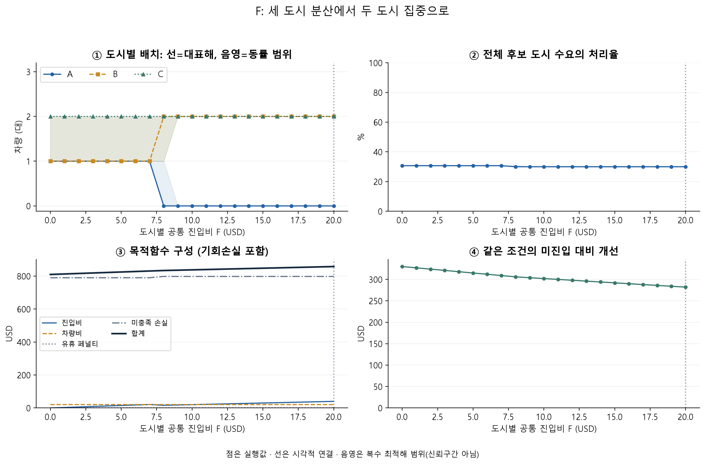
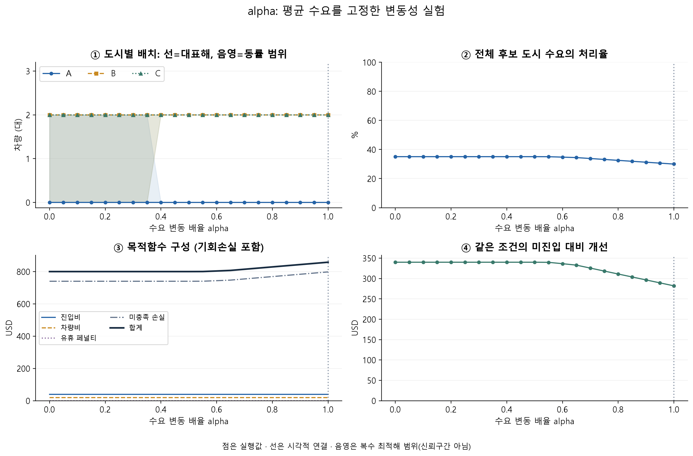
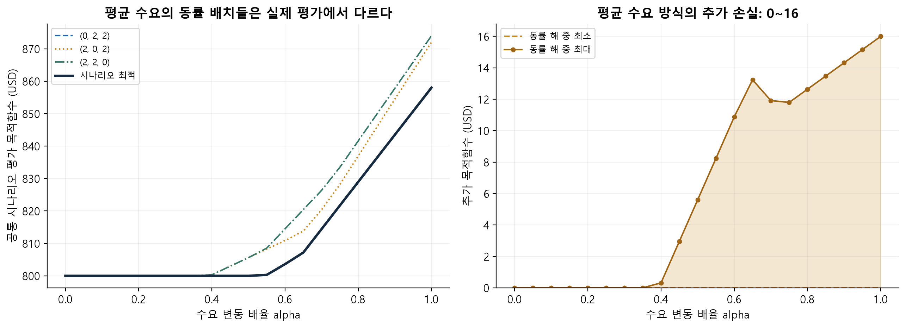

# 작은 사례 기본 모형 수치실험

기본 모형의 수식·구현·경제적 해석이 일치하는지 직접 확인 가능한 사례에서 점검하고, 진입비·용량·수요변동의 영향을 분석합니다.

[전체 보고서](small_case%28%ED%95%9C%EA%B8%80%29.pdf) · [한글 노트북](baseline_smallcase%28%ED%95%9C%EA%B8%80%29.ipynb) · **[Colab 실행](https://colab.research.google.com/drive/1VT-cDsVp_YqmNhzPgUUk2LuJHBpc97tK)**

## 세팅과 선택 이유

실제 도시 관측이나 문헌 보정이 아닌 **직접 설계한 합성값**입니다. 작은 정수로 전수계산과 비용 비교를 가능하게 하고, 시장규모만 다르게 하여 다른 도시 조건의 영향을 분리합니다.

| 입력 | 설정 | 설계 이유 |
|---|---|---|
| 도시·시장규모 | A·B·C, 80·100·120 | 단순한 시장 이질성 |
| 공동 시나리오 | 고정 10행·동일 확률; 선택값 0.05·0.2·0.5·0.8 | 저수요·고수요·혼합 상황, 동일 주변분포·평균 0.38 |
| 용량 | 생산성 10, 도시 상한 2, 전체 4 | 집중 배치와 추가 진입의 선택 유도 |
| 비용 | 진입 20, 차량당 연간 5 | 직접 비교 가능한 고정비 절충 |
| 유휴·부족 | 0·10 | 추가 유휴비용 없는 기준에서 시작해 민감도로 확장 |
| 기간 | 진입 후 1년 | 진입 1회와 연간 수요·차량비·용량 정합 |

각 행은 하나의 공동 상황이며 모든 조합으로 확장하지 않습니다. 선택확률과 발생확률 0.1은 다릅니다. 배치는 공통이고 도시 간 용량 공유가 없으며 미진입 수요도 부족에 포함됩니다.

## 모형 점검과 확인한 점

| 질문 | 검사 | 확인·의미 |
|---|---|---|
| 정식화와 MILP 일치 | 가능 결정 60개 독립 전수계산 | 차량을 덜 쓰는 대안까지 포함한 최적값 일치 |
| 결정·결과의 실행 가능성 | 정수·이진·한도·비음수·균형 | 보고된 검사 통과, 수요·용량으로 결과 재계산 |
| 경계 동작 | 차량/수요 0·도시 금지·부족비용 0·큰 진입비·느슨한 한도·진입비 0·정확 균형 | 서비스 유인이 없으면 미배치, 도시 상한으로 차량 잔여 가능 |
| 진입 경제성 | 추가 처리 공헌과 진입비 비교 | 추가 0.8건의 공헌 8보다 진입비 20이 큼 |
| 대표해만으로 무민감 판단 가능? | 전체 동률·운영 성과 추적 | 대표해가 그대로여도 비용·동률 집합은 변함 |

```math
T_c^s=\min(D_c^s,\kappa_cq_c),\quad
O_c^s=(\kappa_cq_c-D_c^s)_+,\quad
U_c^s=(D_c^s-\kappa_cq_c)_+.
```

목적함수는 초기 진입·연간 차량·기대 유휴/부족 비용입니다. 검증은 이 설정의 구현에 대한 것이며 실제 수요 모형의 타당성을 입증하지 않습니다.

## 민감도: 모형은 무엇에 반응하는가?

한 입력씩 바꾸어 재최적화하고 배치·처리율·비용 분해·미진입 대비 개선을 함께 봅니다. 기준 비용도 바뀐 입력으로 재계산합니다.







**진입비:** 추가 도시의 처리 공헌 8로 공통 진입비 8에서 동률·전환이 설명됩니다.

| 입력 | 확인 내용 |
|---|---|
| 전체 차량 0–8 | 도시 상한 합계 6을 넘으면 더 배치할 수 없음 |
| 생산성 5–20 | 높은 생산성은 세 도시 배치를 유리하게 만들 수 있음; 유휴비용 0이면 최적 목적값 악화 불가 |
| A 시장규모 0.5–2배 | 한 도시의 평균과 변동 폭을 함께 변경 |
| 유휴 페널티 0–20 | 비용식 858+5.8배와 870+5배가 계수 15에서 만남; 0·2·5만 보면 전환을 놓침 |
| 평균 고정 변동성 0–1 | 평균을 유지해 불확실성만 바꾸며 새 표본은 뽑지 않음 |

**변동성:** 0에서는 집중 배치 세 개가 동률이지만 원래 변동에서는 B·C 배치만 최적입니다. 대표 배치가 같아도 비용은 800→858로 바뀝니다.

**공통 평가:** 평균수요로 구한 모든 동률 결정을 원래 10개 상황에서 평가해야 합니다. 서로 다른 분포의 목적값 800과 858을 직접 비교하지 않습니다.

## 재현 기준 결과

기준 입력에서 B·C 진입, 차량 (0,2,2), 비용 **858**(진입 40+차량 20+부족 798)입니다. 기대 114건 중 34.2건 처리(30%), 미진입 대비 개선 282입니다. 실제 도시 권고가 아닌 검증 기준입니다.

## 코드와 재현

**[Colab](https://colab.research.google.com/drive/1VT-cDsVp_YqmNhzPgUUk2LuJHBpc97tK)**에서 MILP→전수계산·실행가능성→8개 경계→민감도→평균수요 공통평가 순서로 실행합니다. [저장 노트북](baseline_smallcase%28%ED%95%9C%EA%B8%80%29.ipynb)은 NumPy·pandas·SciPy/HiGHS·Matplotlib를 사용하고 필요한 패키지를 설치합니다. 외부 수요 파일·상용 솔버는 필요하지 않습니다. 음영은 동률 범위입니다.

Colab은 접근 권한이 있는 Drive 원본을 엽니다. GitHub 노트북은 저장된 사본이며 자동으로 동기화되지 않습니다.

**기존 폴더 배치 안내:** 이 한글 폴더에는 [연간 큰 사례 코드](baseline_largecase%28%ED%95%9C%EA%B8%80%29.ipynb) · [Colab](https://colab.research.google.com/drive/1YsArFdKTv3LFnlhcAC__o0PlrfRD-eEx)도 함께 있습니다. 큰 사례 보고서와 그림은 [영문 큰 사례 안내](../../../../B.%20baseline_model/2%29%20numerical_experiments/large_case/README.md)에서 확인하며, 이 페이지의 그림·검증 수치는 작은 사례입니다.

---

[상위 안내](../README.md) · [전체 연구 안내](../../../../../README.md)
