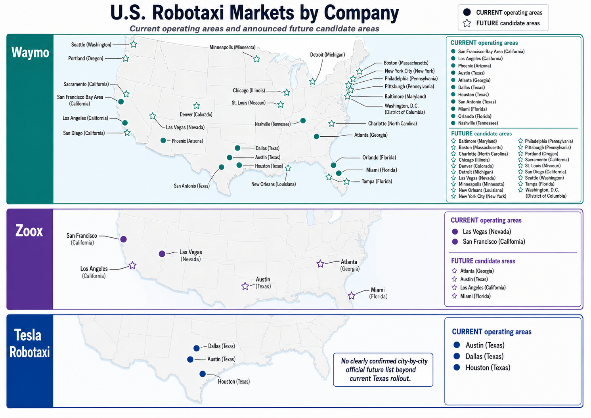

# Market and demand evidence

## What each document contributes

- **Companies and markets:** separates current public-rider markets from announced expansion, testing, and rollout stages for Waymo, Zoox, and Tesla. It supports candidate screening, not a verified universal feasibility set.
- **Demand-variable review:** distinguishes direct robotaxi trip evidence, conventional ride-hailing evidence, and stated-choice/acceptance studies. The SF robotaxi study covers 194 tracts over September 2023–August 2024; its local trip associations are not automatically between-city choice effects.
- **Entry conditions:** separates confirmed prerequisites/enablers, operational events demonstrating risk, and public-data proxies. ODD includes geography, road types, weather, lighting, speed, and traffic conditions.

## Evidence-to-input rules

| Evidence | What it can support | What it cannot establish alone |
|---|---|---|
| Observed robotaxi trips | Local associations with actual use | Unconstrained demand or separate effects on $M$ and $p$ |
| Conventional ride-hailing | Candidate scale/access variables | Direct robotaxi effect sizes |
| Stated-choice experiment | Fare/wait/support trade-offs | Realized city-level market shares |
| Public data (ACS, SLD, GTFS, NOAA) | Consistent variable measurement | Causality or a predetermined coefficient sign |

Operator-market illustration from the project background review; operating status is a source-dated snapshot.

The market image illustrates the inventory described in the accompanying document; it is a snapshot, not live operating coverage. Use comparable geography and service conditions when turning this research into candidate-city inputs.

## Documents and their contents

- **[02_demand_variables.pdf](02_demand_variables.pdf)** — Separates observed robotaxi, conventional ride-hailing, and stated-choice evidence; maps candidate variables to comparable measurement data.
- **[01_robotaxi_companies_markets.pdf](01_robotaxi_companies_markets.pdf)** — Operator-specific market inventory with public-service versus announced/testing/rollout distinctions; document snapshot rather than live coverage.
- **[03_city_entry_conditions_variables.pdf](03_city_entry_conditions_variables.pdf)** — Distinguishes operating prerequisites, demonstrated operational risks, and constructed public-data proxies for entry feasibility.

---

[Parent guide](../README.md) · [Project overview](../../../README.md)
